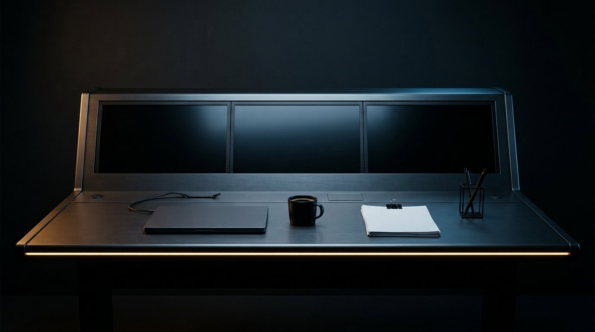

# Java4Shell Reel — "Herufi 65. Ndio zote."

**v2 (current, desk set):** <https://drive.google.com/file/d/1fVt__72-QRbI3YZSeTdoEI2O83IUA3DT/view>
**v1 (superseded — she floated, "hana legs"):** <https://drive.google.com/file/d/1Ct1F8J6gbJdUU1JWJzm6uqUlryHXTkL5/view>
1080×1920 · 60 fps · 46.58 s · H.264 yuv420p + AAC 48 kHz stereo.

## The observation

CVE-2026-114938, disclosed 17 November 2026. An AI agent (OpenAI Codex, driven
by Quang Luong at Calif) found a heap overflow in OpenJDK's AVX-512 Base64
decoder in about an hour, then built a working exploit in two more hours, for
under $200 in tokens. Pre-auth RCE was demonstrated against default installs of
Keycloak, Jira, Confluence, JFrog Artifactory, Jenkins and PingFederate.

Every figure on screen comes from the public advisory, the Calif write-up and
Oracle's November 2026 CPU. Nothing is estimated.

## Beats

| # | beat | the artifact | why that pose |
| --- | --- | --- | --- |
| 1 | hook | 20 Base64 cells, the last one red, `64 × A + 1 × =` | wave — the intro to the claim |
| 2 | found | three time bars: months / ~1 hour / +2 hours | desk — presenting a comparison |
| 3 | bug | a 50-byte buffer with 62 bytes drawn outside it | point — pointing at the overflow |
| 4 | apps | six app chips marked red, five more after login | cheer — the scale of it |
| 5 | patch | two fix cards: update, or `-XX:-UseBASE64Intrinsics` | ok — the fix is fine |
| 6 | action | three checks in order | pray — this is on you today |
| 7 | cta | **Comment PATCH** + what comes back | peace — sign-off |

## The set, and why there is a desk

Her rig is half-body: the PNG stops across the hoodie. v1 faded that cut into
the floor, which hid it but left her floating — the note came back as "hana
legs", and it was right.

v2 puts a real console **in front of her**, drawn in two passes (`set.mjs`):

- `drawDeskBack` before her — monitors, the back of the surface, the room;
- `drawDeskFront` after her — only the surface from the lip down, which crops
  her at the waist the way a news desk crops a presenter.

On top of that: paper cutouts on the desk (torn edges, staggered 20–80 frames),
corner brackets and scale ticks around the artifact band, one pulse travelling
the desk lip in the beat's accent colour, and a key light behind her head so the
hoodie separates from the dark plate.



## Why it is not the school Reel

- Dark machine room (a generated server-corridor plate), not an eggshell page.
- Red is reserved for the bug. Mint is the fix. Amber is the clock.
- The artifact band is the same box on every beat (`y 452 → 900`) and she starts
  below it at 880–936, so this reads as the same series as Shule and Ship.
- Type is native UI: a byte ruler, a heap diagram, an app matrix, a fix card.
- She stands **behind a console**, framed by brackets and paper — not against a
  gradient with a caption band under her.

## Rebuild

```bash
export FFMPEG=$(ls $PWD/.cache/rt/imageio_ffmpeg/binaries/ffmpeg-* | head -1)
PYTHONPATH=$PWD/.cache/rt python3 production/java4shell-reel/mix.py
PYTHONPATH=$PWD/.cache/rt python3 production/noellyne-host/lipsync.py \
  production/java4shell-reel/out/mix.wav production/java4shell-reel/out/mouth.json --fps 60
node production/java4shell-reel/render.mjs \
  production/java4shell-reel/out/java4shell.mp4 production/java4shell-reel/out/mix.wav
```

`--stills=hook:200,bug:1100` writes full-res PNGs and exits — always pull stills
from 40–70 % through a beat, never from the entrance ramp.

## Sources

- Tenable, Java4Shell FAQ — <https://www.tenable.com/blog/java4shell-cve-2026-114938-frequently-asked-questions-about-openjdk-rce-vulnerability>
- JFrog Security Research — <https://research.jfrog.com/post/java4shell-vulnerability/>
- SocRadar — <https://socradar.io/blog/java4shell-cve-2026-114938-openjdk-rce/>
- Ostorlab — <https://blog.ostorlab.co/java4shell-openjdk-base64-rce-cve-2026-114938.html>
